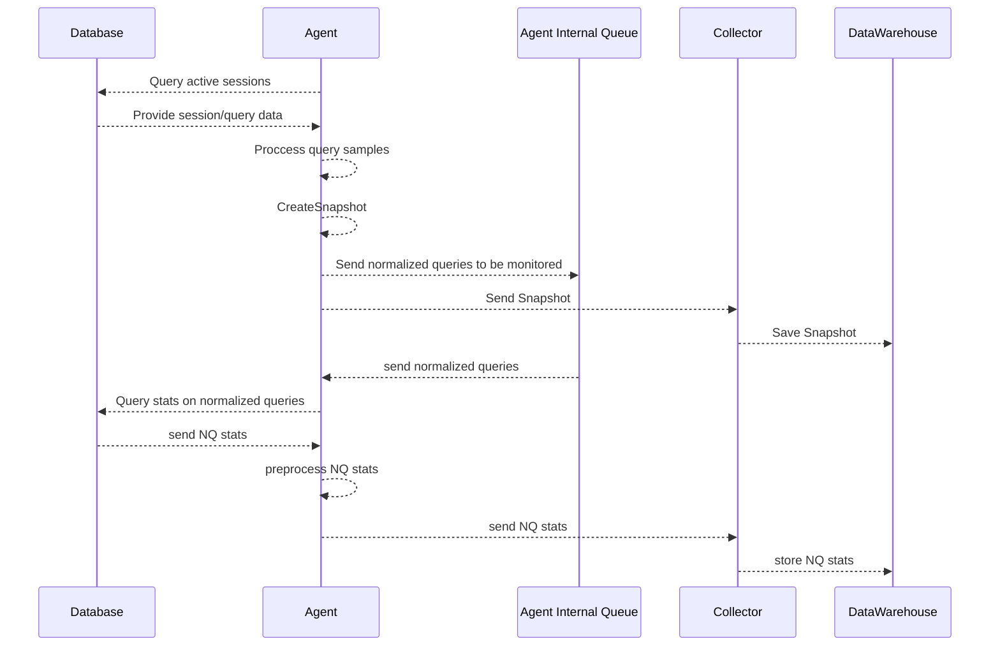

## databases
- active connections
- blocking history
- session graphs
- top queries
- deadlocks

## db snapshots
- samples from snapshot
- blocking tree
- wait events
- time elapsed

## sample
- link to normalized query
- details
- exec plan
- blocking tree

## normalized query
- statistics
- link to samples
- execution plan history
- blocking history

## V1 Features Removed & Pending Redesign for V2

The legacy v1 services (`agent`, `collector`, `ui`) were removed ahead of the v2.0.0 stable release. The following v1 capabilities were not carried forward as-is and should be redesigned cleanly for v2+:

1. **Query Metrics Collection on the Agent**
   - **What v1 had**: `MetricsCollector` polled `sys.dm_exec_query_stats` on a 1-minute interval, computed per-`query_hash` counter deltas (`executionCount`, `totalWorkerTime`, `totalLogicalReads`, `totalPhysicalReads`, `totalLogicalWrites`, `totalElapsedTime`, `totalRows`, `totalSpills`, memory grant/thread/columnstore counters), and uploaded them via `IngestMetrics`.
   - **Current v2 state**: v2 Ingester (`IngestMetrics`), Querier (`ListQueryMetrics`, `GetQueryMetricsTimeSeries`), PostgreSQL schema (`query_stat_snapshot`, `query_stat_sample`), retention purge (`PurgeQueryMetricsTask`), and Grafana plugin (`metrics`, `metrics_series`, and the "Executions over time" chart in `QueryDetails`) are already wired — only the v2 Agent collection task + SQL Server query + `SendMetrics` client method are missing.

2. **Prometheus Lock Metrics**
   - **What v1 had**: `MetricsDetector` inspected each captured snapshot, extracted table names from blocked SQL text via regex (`DefaultSQLParser`), and emitted `sqlsights_database_lock_duration_seconds` (histogram by `server`, `database`, `wait_type`, `table`) and `sqlsights_database_locks_total` (counter by `server`, `database`).
   - **Current v2 state**: Not present in v2; candidate for redesign using parsed plan objects / DMV lock metadata instead of regex SQL parsing.

3. **Per-Target Database Whitelist / Filtering**
   - **What v1 had**: Top-level `databases` list in `agent.toml` filtered captured snapshot samples and query metrics by database name.
   - **Current v2 state**: `SqlServerSnapshotter.TakeSnapshot` and `CollectSnapshotTask` already accept `databases []string`, and `internal/config/target.go` defines `DBFilter` (`all`/`whitelist`/`blacklist`), but `TargetConfig` in `internal/services/v2/agent/service/config.go` does not yet expose database filter config (always passes an empty slice).

4. **Standalone Warnings API & Table**
   - **What v1 had**: `IngestWarnings` / `GetKnownWarnings` gRPC endpoints and `warnings` PostgreSQL table (plus an unfinished `PlanWarningDetector` event processor).
   - **Current v2 state**: Superseded for execution plans by `AnalizePlansTask` + `query_plans` analysis columns (`missing_indexes`, `implicit_conversions`, `large_table_scans`, `has_problems`) + `ListPlansWithIssues`. Note that `large_table_scans` detection logic/thresholds are not implemented yet.

5. **Manual Admin / Support RPCs & Paginated Snapshot Listing**
   - **What v1 had**: `DBMSupportApi` (`PurgeQueryMetrics`, `PurgeQueryPlans`), `ListSnapshots` (paginated), and single-query `GetQueryMetrics`.
   - **Current v2 state**: Purging is automated via Ingester background tasks (`PurgeSnapshotsTask`, `PurgeQueryMetricsTask`, `PurgePlansTask`). `QuerierAPI` uses `ListSnapshotSummaries` + `GetSnapshot` instead of paginated `ListSnapshots`.

6. **Standalone HTMX Web UI (`dbm ui`)**
   - **What v1 had**: Go `html/template` + HTMX server (`internal/services/ui`, `templates/`, `static/`).
   - **Current v2 state**: Fully replaced by the Grafana App & Datasource plugin (`pkg/plugin/`, `src/`).

