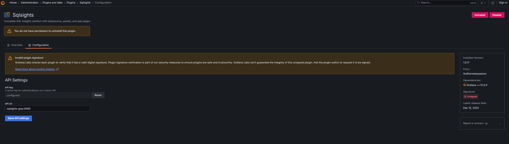
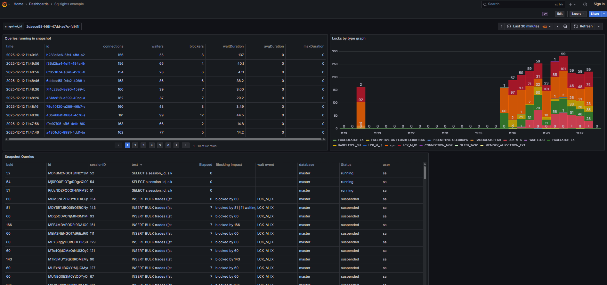

# Sqlsights
Sqlsights is a open source database monitoring project to collect and extract insights from production databases, allowing easy debugging of problems and retrieving insights on potential improvements on your applications

This tool is for those who have database-heavy applications, that sometimes underperform, so you can quickly and autonomously see long running queries, locks, inspect execution plans and gather insights on how to enhance your app without a DB admin, empowering the developers and allowing them to work more autonomously

So far only supports MS Sql Server databases
# Core Features
| Feature Group     | Feature                               | Stage    | Release |
|-------------------|---------------------------------------|----------|---------|
| Session Snapshots | Session Snapshots                     | Released | v1.0.0  |
| Session Snapshots | Lock/Wait detection                   | Released | v1.0.0  |
| Normalized Query  | Execution plan extraction             | Released | v1.0.0  |
| Normalized Query  | Query Stats                           | Released | v1.0.0  |
| Normalized Query  | Execution plan history                | planned  | TBD     |
| Normalized Query  | deadlock detection                    | planned  | TBD     |
| Session Snapshots | Summary data (queries/s, connections) | planned  | TBD     |
| Normalized Query  | Lock history                          | planned  | TBD     |
| Metrics           | Prometheus lock metrics for alerting  | Beta     | TBD     |

# Grafana plugin
The sqlsights grafana plugin allows visualization of the collected data through grafana, so you can onboard it on your monitoring dashboards
It includes a datasource plugin bundled and will include pre-built pages for easier exploration and analysis


# Grafana Sqlsights datasource
## Configuration

Configure the Sqlsights Grafana app plugin under **Apps → Sqlsights → Configuration**:
- **API Url**: `host:port` of your Sqlsights Querier gRPC endpoint (e.g., `sqlsights:9014`).
- **Tempo Datasource** *(optional)*: Select a Grafana Tempo datasource to enable one-click navigation from SQL samples carrying a `trace_id` directly into Grafana Explore.

## Distributed Trace Correlation (Tempo)

Sqlsights can correlate SQL Server session snapshots, blocking chains, and problematic execution plans with OpenTelemetry distributed traces using SQL Server's `CONTEXT_INFO` register (`TPRC` binary header) and Grafana Tempo.

- Local `docker-compose.yml` includes a pre-configured **Tempo** service (`tempo.yaml`), OTel Collector fan-out (`otel-collector-config.yaml`), and auto-provisioned Grafana Tempo datasource (`provisioning/datasources/datasources.yml`).
- See [docs/trace_correlation.md](docs/trace_correlation.md) for the binary payload specification, Go / .NET / Node.js instrumentation examples, connection-pooling best practices, and verification steps.
for now, configure the app plugin with host:port to your sqlsights instance


## Query types (Explore & Dashboards)

The bundled **SQL Sights Data source** can be used in Grafana **Explore** and custom **Dashboards** (with full `$variable` interpolation and clickable Data Links into the Sqlsights app pages):

| Query Type | Value | Best Visualization | Description |
| :--- | :--- | :--- | :--- |
| **Activity by Wait Event** | `chart` | Stacked Bar / Time Series | Active connections or wait time (ms) grouped by wait event over time (supports optional wait event filter). |
| **Connections & Blocking** | `blocking_timeseries` | Time Series / Stat | Active connections, blockers, waiters, and wait duration (s) over time. |
| **Wait Events Summary** | `wait_breakdown` | Pie Chart / Bar Gauge / Table | Total connections, wait time (ms), and share % per wait event across the selected range. |
| **Snapshots List** | `snapshot-list` | Table | Snapshot summaries (optional `Only Blocking` & wait event filters) with click-through to Sqlsights Snapshots. |
| **Snapshot Samples** | `snapshot` | Table | Active queries inside a snapshot ID (supports `$var`, database, and blocking filters). |
| **Bad Execution Plans** | `plan_analysis` | Table | Problematic plans filtered by database(s), issue type (`seek_plan_convert`, `missing_index`, `cardinality_convert`), lock involvement, min impact %, and search. |
| **Plan Analysis KPIs** | `plan_analysis_summary` | Stat / Bar Gauge | Single-row KPI counts (`totalPlans`, `seekPlanConversions`, `cardinalityConversions`, `missingIndexes`, `relatedLocks`, `maxImpact`) for executive/team dashboards. |
| **Monitored Servers** | `servers` | Table / Stat | Overview of all active SQL Server instances in the selected time range. |
| **Query Metrics Summary / Series** | `metrics` / `metrics_series` | Table / Time Series | Per-query execution counters and time-series trends by Query Hash. |

### Dashboard Query Variables
Configure Grafana Dashboard variables of type **Query** using the Sqlsights datasource:
- `servers` — lists monitored SQL Server instances
- `databases($server)` — lists databases observed on `$server`
- `snapshots($server)` — lists recent snapshot IDs on `$server`
- `issue_tags` — lists execution plan issue tags (`seek_plan_convert`, `missing_index`, etc.)

## Example dashboard
dashboard combining the queries, with a data link on snapshot id so we can navigate between the snapshots


## Contributing

Got ideas or feedback? Your contributions help make this plugin better. Share your thoughts and code improvements on GitHub.
## create new migration
```shell
migrate create -ext sql -dir sql/migrations/ <filename>
```
## Creating PRs

1. Clone the repository
2. Create a dev branch

3. Install dependencies

   ```bash
   npm install
   ```

4. Build plugin in development mode and run in watch mode

   ```bash
   npm run dev
   ```

5. Build plugin in production mode

   ```bash
   npm run build
   ```

6. Run the tests (using Jest)

   ```bash
   # Runs the tests and watches for changes, requires git init first
   npm run test

   # Exits after running all the tests
   npm run test:ci
   ```

7. Spin up a Grafana instance and run the plugin inside it (using Docker)

   ```bash
   npm run server
   ```

8. Run the E2E tests (using Cypress)

   ```bash
   # Spins up a Grafana instance first that we test against
   npm run server

   # Starts the tests
   npm run e2e
   ```

9. Run the linter

   ```bash
   npm run lint

   # or

   npm run lint:fix
   ```

## License

This plugin is licensed under the Apache-2.0 license.